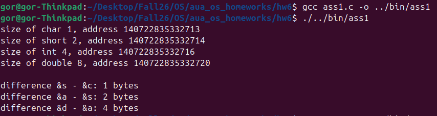
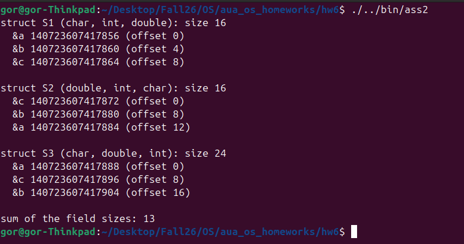
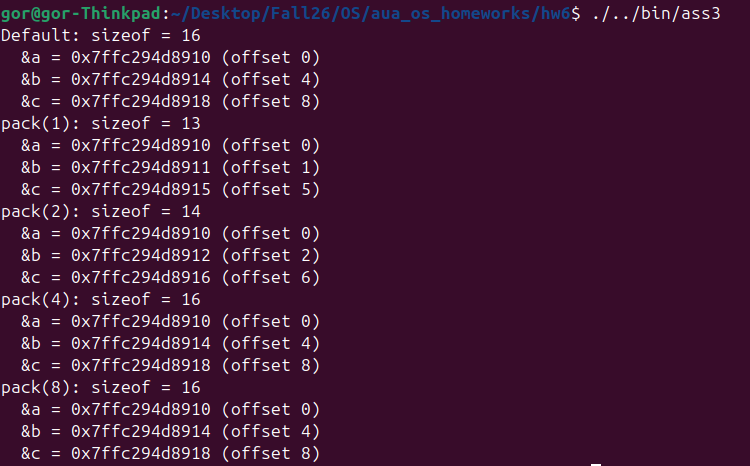

# Homework 6 — Data Alignment, Struct Padding and `#pragma pack`

**Repository:** https://github.com/GorArzanyanAUA/aua_os_homeworks

**Author:** Gor Arzanyan

```
cd hw6
gcc ass1.c -o ../bin/ass1
../bin/ass1
```

---

## Background — the alignment rule

**Alignment requirement** equal to its size: a value of
that type must start at an address that is a multiple of that number.

| type | `sizeof` | must start at an address divisible by |
|---|---|---|
| `char` | 1 | 1 (any address) |
| `short` | 2 | 2 |
| `int` | 4 | 4 |
| `double` | 8 | 8 |

The CPU reads memory in aligned chunks, so an aligned value can be loaded in one access,
while a misaligned one may span two chunks. To keep every value aligned the compiler inserts
unused bytes, called **padding**. A struct has two extra rules:

- each field is placed at the next offset that satisfies its own alignment;
- the size of the whole struct is rounded up to a multiple of its largest field alignment
  (**tail padding**), so that every element of an array of structs is aligned too.

---

## Task 1 — Understanding data alignment

```c
#include<stdio.h>
#include<stdint.h>
#include<inttypes.h>

int main() {
    int a = 15;
    char c = 'a';
    double d = 12;
    short s = 5;

    printf("size of char %ld, address %" PRIuPTR "\n", sizeof(c),  (uintptr_t)&c);
    printf("size of short %ld, address %" PRIuPTR "\n", sizeof(s), (uintptr_t)&s);
    printf("size of int %ld, address %" PRIuPTR "\n", sizeof(a),  (uintptr_t)&a);
    printf("size of double %ld, address %" PRIuPTR "\n", sizeof(d),  (uintptr_t)&d);

    // differences follow the order the variables are stored in, from lowest address to highest
    printf("\ndifference &s - &c: %td bytes\n", (char *)&s - (char *)&c);
    printf("difference &a - &s: %td bytes\n", (char *)&a - (char *)&s);
    printf("difference &d - &a: %td bytes\n", (char *)&d - (char *)&a);

    return 0;
}
```

**How it works.** Four local variables of different types are declared in the order `int`,
`char`, `double`, `short`. The program prints `sizeof` of each one and its address, cast to
`uintptr_t` so it is printed as a plain decimal number that is easy to check for
divisibility. The last three lines print the distance in bytes between neighbouring
variables (the pointers are cast to `char *` so the subtraction counts bytes).

**Output:**




**Observations.**

| variable | size | address | address mod size |
|---|---|---|---|
| `char c` | 1 | …332713 | 0 (anything is fine) |
| `short s` | 2 | …332714 | 0 |
| `int a` | 4 | …332716 | 0 |
| `double d` | 8 | …332720 | 0 |

1. **Every variable is aligned to its own size.** The `short` is at an even address, the
   `int` at a multiple of 4 and the `double` at a multiple of 8. The `char` sits at an odd
   address, which is allowed because a `char` has no alignment requirement.
2. **The compiler reordered the variables.** They were declared as `int, char, double,
   short`, but in memory they lie from the smallest to the largest: `char`, `short`, `int`,
   `double`. The distances between them (1, 2, 4 bytes) are exactly the size of the previous
   variable, so **no byte is wasted** — the 15 bytes of data occupy 15 consecutive bytes.
3. If the variables had been kept in declaration order, padding would have been needed: after
   the `char` the `double` would have to skip ahead to the next multiple of 8, wasting up to 7
   bytes. Grouping the variables by size avoids that.
4. The placement of local variables is the compiler's choice (gcc here), not something the C
   standard guarantees. Another compiler or other flags may order them differently, but each
   variable will still be aligned to its type.

---

## Task 2 — Struct padding

```c
#include<stdio.h>
#include<stdint.h>
#include<inttypes.h>

struct S1 {
    char a;
    int b;
    double c;
};

struct S2 {
    double c;
    int b;
    char a;
};

struct S3 {
    char a;
    double c;
    int b;
};

int main() {
    struct S1 x;
    struct S2 y;
    struct S3 z;

    printf("struct S1 (char, int, double): size %zu\n", sizeof(struct S1));
    printf("  &a %" PRIuPTR " (offset %td)\n", (uintptr_t)&x.a, (char *)&x.a - (char *)&x);
    printf("  &b %" PRIuPTR " (offset %td)\n", (uintptr_t)&x.b, (char *)&x.b - (char *)&x);
    printf("  &c %" PRIuPTR " (offset %td)\n", (uintptr_t)&x.c, (char *)&x.c - (char *)&x);

    printf("\nstruct S2 (double, int, char): size %zu\n", sizeof(struct S2));
    printf("  &c %" PRIuPTR " (offset %td)\n", (uintptr_t)&y.c, (char *)&y.c - (char *)&y);
    printf("  &b %" PRIuPTR " (offset %td)\n", (uintptr_t)&y.b, (char *)&y.b - (char *)&y);
    printf("  &a %" PRIuPTR " (offset %td)\n", (uintptr_t)&y.a, (char *)&y.a - (char *)&y);

    printf("\nstruct S3 (char, double, int): size %zu\n", sizeof(struct S3));
    printf("  &a %" PRIuPTR " (offset %td)\n", (uintptr_t)&z.a, (char *)&z.a - (char *)&z);
    printf("  &c %" PRIuPTR " (offset %td)\n", (uintptr_t)&z.c, (char *)&z.c - (char *)&z);
    printf("  &b %" PRIuPTR " (offset %td)\n", (uintptr_t)&z.b, (char *)&z.b - (char *)&z);

    printf("\nsum of the field sizes: %zu\n", sizeof(char) + sizeof(int) + sizeof(double));

    return 0;
}
```

**How it works.** `S1` uses the order required by the task (`char, int, double`). `S2` is
the reversed order suggested by the task (`double, int, char`). `S3` (`char, double, int`) is
an extra ordering added to show that a bad order can make the struct larger. For every field
the program prints its address and its **offset** from the start of the struct, computed as
the byte distance between the field's address and the struct's address. The last line
prints how many bytes the three fields actually need.

**Output:**




**Memory layout** (each cell is one byte, `.` is padding):

```
S1 (char, int, double)  — 16 bytes, 3 padding
offset  0  1  2  3  4  5  6  7  8  9 10 11 12 13 14 15
        a  .  .  .  b  b  b  b  c  c  c  c  c  c  c  c

S2 (double, int, char)  — 16 bytes, 3 padding
offset  0  1  2  3  4  5  6  7  8  9 10 11 12 13 14 15
        c  c  c  c  c  c  c  c  b  b  b  b  a  .  .  .

S3 (char, double, int)  — 24 bytes, 11 padding
offset  0  1  2  3  4  5  6  7  8 ... 15 16 17 18 19 20 21 22 23
        a  .  .  .  .  .  .  .  c ...  c  b  b  b  b  .  .  .  .
```

### Does changing the order of fields reduce or increase the size of the struct? Why?

It can do either — the fields are the same in all three structs (13 bytes of data), but the
size depends only on the order:

- `char, int, double` → **16 bytes**
- `double, int, char` → **16 bytes** (same size as the original order)
- `char, double, int` → **24 bytes** (50% larger)

For the order given in the task, reversing the fields does **not** change the size: both are
16 bytes, only the position of the padding moves (from the middle to the end). Putting the
`double` between two small fields, however, increases the size to 24 bytes. The reason is
that the amount of padding depends on what comes right before each field: a large,
strictly-aligned field placed after a small one forces a large gap.

### How is memory padding affecting the size of your struct?

Padding is the difference between the struct size and the 13 bytes of real data:

- **S1:** `a` takes offset 0. `b` needs a multiple of 4, so 3 padding bytes are inserted and
  `b` goes to offset 4. `b` ends at 8, which is already a multiple of 8, so `c` goes there
  directly. Total: 1 + 3 + 4 + 8 = 16, which is already a multiple of 8 — no tail padding.
- **S2:** `c` at 0, `b` at 8, `a` at 12, with no gaps between fields. The data ends at 13,
  but the struct size must be a multiple of 8 (the alignment of `double`), so 3 bytes of
  **tail padding** are added: 8 + 4 + 1 + 3 = 16. Without it, the `double` in the second
  element of an array `struct S2 arr[2]` would start at offset 13 and be misaligned.
- **S3:** `a` at 0, then 7 padding bytes so that `c` starts at 8, `b` at 16, data ends at 20,
  and 4 bytes of tail padding round the size up to 24: 1 + 7 + 8 + 4 + 4 = 24.

So padding wastes 3 bytes in S1 and S2 (19% of the struct) and 11 bytes in S3 (46%).
**Rule of thumb:** ordering the fields from the largest alignment to the smallest (as in S2)
gives the minimum padding, because each field then ends at an offset that is already
suitably aligned for the next one.

The output also shows that the structs themselves start at addresses divisible by 8
(…856, …872, …888), since a struct is aligned to its largest field.

---

## Task 3 — Data alignment with `#pragma pack`

```c
#include <stdio.h>
#include <stddef.h>

// Default alignment.
struct Default {
    char a;
    int b;
    double c;
};

#pragma pack(push, 1)
struct Pack1 {
    char a;
    int b;
    double c;
};
#pragma pack(pop)

#pragma pack(push, 2)
struct Pack2 {
    char a;
    int b;
    double c;
};
#pragma pack(pop)

#pragma pack(push, 4)
struct Pack4 {
    char a;
    int b;
    double c;
};
#pragma pack(pop)

#pragma pack(push, 8)
struct Pack8 {
    char a;
    int b;
    double c;
};
#pragma pack(pop)

#define REPORT(label, type)                                                   \
    do {                                                                      \
        type s;                                                               \
        printf("%s: sizeof = %zu\n", label, sizeof(s));                       \
        printf("  &a = %p (offset %zu)\n", (void *)&s.a, offsetof(type, a));  \
        printf("  &b = %p (offset %zu)\n", (void *)&s.b, offsetof(type, b));  \
        printf("  &c = %p (offset %zu)\n", (void *)&s.c, offsetof(type, c));  \
    } while (0)

int main(void) {
    REPORT("Default", struct Default);
    REPORT("pack(1)", struct Pack1);
    REPORT("pack(2)", struct Pack2);
    REPORT("pack(4)", struct Pack4);
    REPORT("pack(8)", struct Pack8);
    return 0;
}
```

**How it works.** The same struct (`char a; int b; double c;`) is defined five times: once
with no pragma (the version **without** `#pragma pack`) and once each under `pack(1)`,
`pack(2)`, `pack(4)` and `pack(8)`. `#pragma pack(push, n)` sets the packing value only for
the struct that follows, and `#pragma pack(pop)` restores the previous setting, so the
packing does not leak into the rest of the file. `pack(1)` is the version required by the
task; `pack(2)`, `pack(4)` and `pack(8)` are the bonus experiment.

To avoid repeating the same five `printf` lines for every struct, a `REPORT` macro declares a
variable of the given type and prints its size, the address of each field and the field's
offset (using `offsetof` from `<stddef.h>`). The `do { ... } while (0)` wrapper makes the
macro behave like a single statement.

**Output:**




(All five variables print the same base address because each `REPORT` declares its variable
in its own block, so the compiler reuses the same stack slot.)

### Before and after `#pragma pack(1)`

```
Default (no pragma) — 16 bytes
offset  0  1  2  3  4  5  6  7  8  9 10 11 12 13 14 15
        a  .  .  .  b  b  b  b  c  c  c  c  c  c  c  c

#pragma pack(1) — 13 bytes
offset  0  1  2  3  4  5  6  7  8  9 10 11 12
        a  b  b  b  b  c  c  c  c  c  c  c  c
```

Without the pragma the struct is 16 bytes, with 3 bytes of padding after `a`. With
`#pragma pack(1)` all padding disappears: `b` starts right after `a` at offset 1 and `c`
right after `b` at offset 5, and the size drops to **13 bytes — exactly the sum of the
fields**. This saves 3 bytes per struct (about 19%), which adds up for large arrays, and
is how structs are matched byte-for-byte to file formats or network packet headers.

The cost is that the fields are now **misaligned**: `b` is at an odd address (`0x…8911`) and
`c` at an address that is not a multiple of 8 (`0x…8915`). On x86-64 the program still works,
but a misaligned access may need two memory reads, so it can be slower. On some other
architectures (older ARM, SPARC) a misaligned access can crash the program. Taking a normal
`int *` pointer to such a field is also dangerous, because code using that pointer assumes it
is aligned.

### Bonus — different packing values

`#pragma pack(n)` does not force every field to `n` bytes; it **caps** the alignment of each
field at `n`. A field's effective alignment becomes `min(natural alignment, n)`:

| packing | align of `char` / `int` / `double` | offset of `a` / `b` / `c` | padding | `sizeof` |
|---|---|---|---|---|
| none (default) | 1 / 4 / 8 | 0 / 4 / 8 | 3 | 16 |
| `pack(1)` | 1 / 1 / 1 | 0 / 1 / 5 | 0 | 13 |
| `pack(2)` | 1 / 2 / 2 | 0 / 2 / 6 | 1 | 14 |
| `pack(4)` | 1 / 4 / 4 | 0 / 4 / 8 | 3 | 16 |
| `pack(8)` | 1 / 4 / 8 | 0 / 4 / 8 | 3 | 16 |

- **`pack(2)`:** `b` only needs an even address, so 1 padding byte puts it at offset 2. `c`
  only needs an even address too, so it starts right after `b` at offset 6. The size is 14,
  which is a multiple of 2, so no tail padding.
- **`pack(4)`:** `b` keeps its natural alignment of 4 (offset 4). `c`'s alignment is reduced
  to 4, but `b` already ends at offset 8, so `c` lands at 8 anyway. For this particular field
  order the result is identical to the default.
- **`pack(8)`:** 8 is not smaller than any field's natural alignment, so nothing changes and
  the layout is the same as the default.

The tail-padding rule follows the packing as well: the struct size is rounded up to a
multiple of its *packed* alignment (1, 2, 4 and 8 respectively), so packed structs also have
a smaller alignment than the default struct.

### How packing affects alignment and size — summary

- A smaller packing value lowers the alignment requirement of the fields, which removes
  padding and makes the struct smaller (16 → 14 → 13 bytes as the value goes 4 → 2 → 1).
- A packing value equal to or larger than the largest field alignment (8 here) has no effect.
- The memory saving comes at the price of misaligned fields, which are slower to access and
  not portable. Packing is therefore used where the exact byte layout matters (file formats,
  network protocols, hardware registers), while ordinary code is better off reordering fields
  from largest to smallest (Task 2), which already removes most padding without misaligning
  anything.
