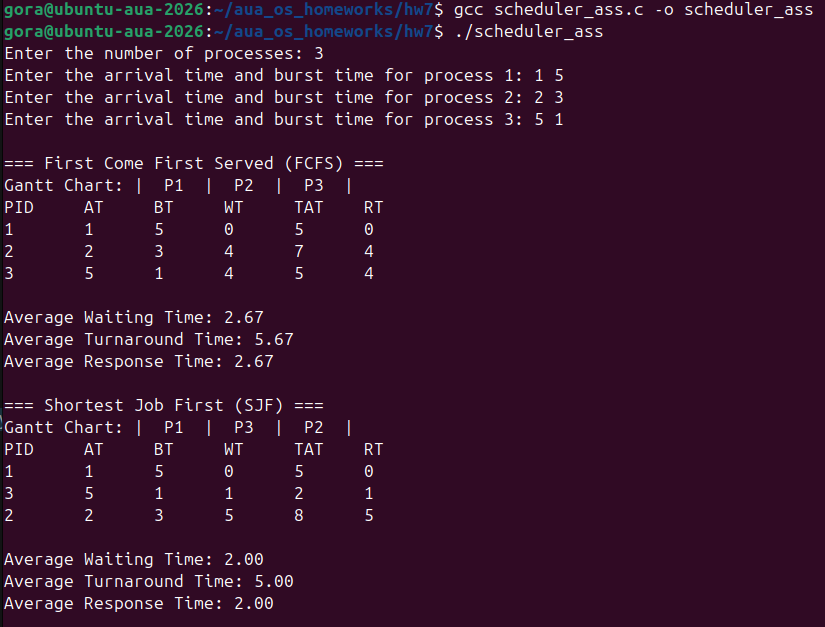

# Process Scheduling Simulator

A C program that simulates two non-preemptive CPU scheduling algorithms:

- **FCFS (First Come First Served):** processes run in order of arrival time. Ties go to the process entered first.
- **SJF (Shortest Job First):** each time the CPU is free, it runs the arrived process with the shortest burst time. Ties go to the earlier arrival.

## Repository

https://github.com/GorArzanyanAUA/aua_os_homeworks (this assignment is in `hw7/`)

```bash
git clone https://github.com/GorArzanyanAUA/aua_os_homeworks.git
cd aua_os_homeworks/hw7
gcc -Wall -o scheduler scheduler_ass.c
./scheduler
```


## Input

Enter the number of processes, then the arrival time and burst time of each process, separated by a space:

```
Enter the number of processes: 4
Enter the arrival time and burst time for process 1: 0 8
Enter the arrival time and burst time for process 2: 1 4
Enter the arrival time and burst time for process 3: 2 9
Enter the arrival time and burst time for process 4: 3 5
```

The program exits with an error if the number of processes is not positive, an arrival time is negative, or a burst time is not positive.

## Sample output

```
=== First Come First Served (FCFS) ===
Gantt Chart: |  P1  |  P2  |  P3  |  P4  |
PID     AT     BT     WT     TAT    RT
1       0      8      0      8      0
2       1      4      7      11     7
3       2      9      10     19     10
4       3      5      18     23     18

Average Waiting Time: 8.75
Average Turnaround Time: 15.25
Average Response Time: 8.75

=== Shortest Job First (SJF) ===
Gantt Chart: |  P1  |  P2  |  P4  |  P3  |
PID     AT     BT     WT     TAT    RT
1       0      8      0      8      0
2       1      4      7      11     7
4       3      5      9      14     9
3       2      9      15     24     15

Average Waiting Time: 7.75
Average Turnaround Time: 14.25
Average Response Time: 7.75
```

**About the SJF Gantt chart.** The assignment's sample shows `| P2 | P4 | P1 | P3 |`, but at t=0 only P1 has arrived, so P1 must run first. That order is also what the sample's own table and averages show (P1 has WT = 0). This program prints `P1 P2 P4 P3`, which matches the sample table.

## Edge cases

- **Idle CPU:** if no process has arrived yet, the CPU stays idle until the next arrival.
- **Same arrival time:** FCFS runs these processes in input order.
- **Same burst time:** SJF runs the one that arrived earlier.

## Screenshots

Run on Ubuntu with 3 processes. In SJF, P3 (burst 1) runs before P2 (burst 3) because both are waiting when P1 finishes at t=6.


